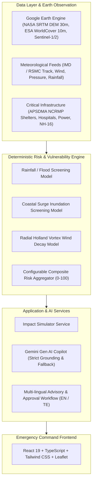

# CycloneShield AI — System Architecture & Methodology

## 1. System Overview

CycloneShield AI integrates satellite Earth observation, meteorological forecasts, road networks, and critical facility datasets into a unified command dashboard for pre-landfall disaster risk reduction.

## 2. Risk Calculation Formulas

### A. Rainfall / Flood Susceptibility ($S_{flood}$)
$$S_{flood} = \min\left(100, \left(0.45 \cdot f_{rain} + 0.35 \cdot f_{elev} + 0.20 \cdot f_{drain}\right) \cdot M_{imperv}\right)$$
- $f_{rain} = \min(100, \frac{\text{Rainfall}_{24h}}{350} \times 100)$
- $f_{elev} = \max(0, 100 - (\text{Elevation} \times 4.0))$ for elevations $<25m$
- $f_{drain} = \max(0, 100 - (\text{Dist}_{\text{waterway}} \times 25.0))$
- $M_{imperv} \in [0.65, 1.20]$ based on ESA WorldCover land use (dense urban = 1.20, forest = 0.65)

### B. Coastal Surge Screening ($S_{surge}$)
$$S_{surge} = \min\left(100, \text{HeadScore} \cdot 0.70 + (\exp(-\text{Dist}_{coast} / 4.0) \cdot 100) \cdot 0.30\right)$$
- $\text{EffectiveHead} = \max(0, \text{SurgeHeight} - \max(0, \text{Elevation}))$
- $\text{HeadScore} = \min(100, \frac{\text{EffectiveHead}}{4.0} \times 100)$

### C. Wind Exposure ($S_{wind}$)
$$W_{local} = W_{max} \cdot \left(\frac{R_{max}}{D_{track}}\right)^{0.55} \quad (\text{for } D_{track} > R_{max})$$
$$S_{wind} = \min\left(100, \frac{W_{local}}{200} \times 100 \times M_{structural}\right)$$
- $M_{structural}$: Reinforced concrete = 0.85, Masonry = 1.15, Tin/Temporary roof = 1.40

### D. Composite Risk Aggregation
$$R_{composite} = w_{flood} \cdot S_{flood} + w_{surge} \cdot S_{surge} + w_{wind} \cdot S_{wind}$$
- Default weights: $w_{flood} = 0.35, w_{surge} = 0.35, w_{wind} = 0.30$
- Categories: Low ($<25$), Moderate ($25-50$), High ($50-75$), Critical ($>75$).

## 3. Human-in-the-Loop & Safety Architecture

1. **Automated Alert Prohibition:** System explicitly blocks automated broadcast triggers.
2. **Reviewer Signature:** Advisory drafts require reviewer name, official title, and verification notes before the approval flag is updated in SQLite.
3. **Grounding Guardrails:** Gemini prompts enforce strict evidence JSON injection and forbid hallucinating unlisted road closures or official orders.
